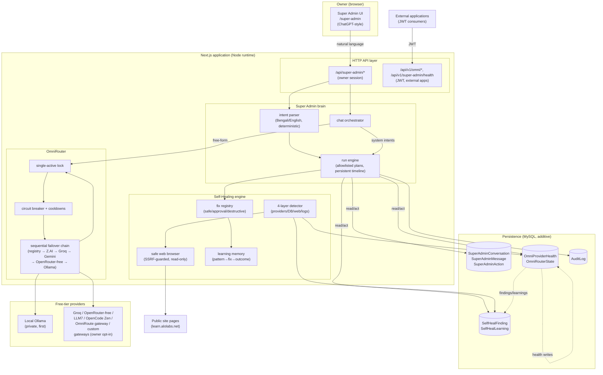

# Super Admin Command Center — Omni-Routing & Self-Healing Architecture

Professional AI-development protocol document for the ALO Learning Journey
platform's Super Admin system: a ChatGPT-style command center where the owner
gives natural-language instructions and the platform executes allowlisted
operations, omni-routes AI traffic across free-tier providers, and
self-detects + self-corrects errors.

**Status:** implemented, additive-only. Production deployment follows the
standard rehearsal in `MIGRATION-RECOVERY-PLAN.md` — nothing in this feature
touches the production database until that review passes.

---

## 1. Requirements traceability

| Requirement | Where it is enforced |
|---|---|
| ChatGPT-like Super Admin dashboard as central hub | `src/app/super-admin/page.tsx` (conversations sidebar, chat pane, system monitor) |
| Natural-language instructions → AI executes | `src/lib/super-admin/intents.ts` → `runs.ts` (run engine) → allowlisted operations, recorded as a persistent run timeline |
| Automatic error correction: browse internet, detect, fix | `src/lib/self-heal/` (safe browser → detector → fixer) |
| Not all AI systems active simultaneously | `src/lib/omni/router.ts` — single-active in-flight lock + strictly sequential chain |
| Professional AI protocols + architecture diagrams | This document, §2–§6 |
| Self-learning, proactive | `src/lib/self-heal/learner.ts` — pattern→fix→outcome memory, suggestions by success rate |
| Free-tier only, open-source providers | `src/lib/omni/catalog.ts` + payment guard + free-model guards in `external-ai.ts` / `ai-chain.ts` |
| Omni-routing / switching between providers (300+ free APIs) | `src/lib/omni/router.ts` wraps the registry-driven `ai-chain.ts` chain; catalog documents 300+ free models on OpenRouter alone |
| Strong API architecture for external apps | `/api/v1/omni/*` service endpoints (JWT) + `/api/v1/super-admin/health` (role-gated) + OpenAPI 3.1 spec in `src/lib/openapi-spec.ts` |

---

## 2. System architecture



ASCII overview (for tools without Mermaid):

```
Owner ──▶ /super-admin (ChatGPT-style UI)
             │ natural language (Bengali/English)
             ▼
      /api/super-admin/* ── owner session (requireOwner)
             │
     ┌───────┴────────┐
     ▼                ▼
 intent parser    chat orchestrator
 (deterministic)        │
     ▼                  │ free-form questions
 run engine ─────────┤
 (allowlisted plans)  ▼
     │            OmniRouter ── single-active lock
     │                   │        ├─ 1) Local Ollama (private, free)
     │                   │        └─ 2) chainChat failover (sequential):
     │                   │             registry (owner) → Z.AI → Groq →
     │                   │             Gemini → OpenRouter-free → Ollama
     ▼                   ▼
 Self-Heal: safe browser (SSRF-guarded) → 4-layer detector
   → fix registry (safe | approval | destructive-blocked)
   → learning memory (pattern → fix → outcome)
     │
     ▼
 MySQL (additive tables) + AuditLog (every action)

External apps ── JWT ─▶ /api/v1/omni/chat, /api/v1/omni/providers,
                         /api/v1/super-admin/health (super_admin role)
```

---

## 3. Omni-routing protocol

**Rule 1 — Single-active.** At any moment exactly ONE model is being called.
Enforced twice: (a) the chain is strictly sequential — no parallel fan-out;
(b) a process-level in-flight lock rejects a second routed call with
`omni_router_busy` until the first settles.

**Rule 2 — Local first.** Local Ollama is always tried before any external
provider. Private data never leaves the server when a local model is
available, and local inference costs nothing.

**Rule 3 — Free-tier only.** Every external hop passes the fail-closed
payment guard (`isExternalAiAllowed()`): both owner switches
(`ALO_PAID_AI_API_ALLOWED`, `ALO_OWNER_APPROVED_PAID_AI_API`) must be true,
and OpenRouter is restricted to free model ids (`*:free`), LLM7's paid
`pro` selector is blocked, and OpenCode Zen only serves free models.
The router refuses to run when the guard is off — it reports
`external_ai_blocked_by_payment_guard` instead of silently calling paid APIs.

**Rule 4 — Circuit breaker.** 5 consecutive failures put a provider into a
60 s cooldown (half-open probe after expiry). Health is persisted to
`OmniProviderHealth`; in-memory state stands in when the DB is unavailable
(pre-migration), so the router degrades gracefully but never lies.

**Rule 5 — Honest degradation.** When no real model answers, the router
throws (never serves the rule-based echo as if it were an AI answer) and the
UI/API say exactly that.

**Switching.** The owner pins a preferred provider from the UI, the chat
("switch provider to groq"), or the API. Full failover order =
owner-configured registry priorities (`AiModelProvider` table, managed in the
existing AI Models view) → built-in chain. The catalog
(`src/lib/omni/catalog.ts`) documents the wider free-tier landscape —
including 300+ free models reachable on OpenRouter — and the exact steps to
add a provider via `ALO_CUSTOM_AI_PROVIDERS_JSON`. Catalog-only entries are
documented, never auto-called: a free-tier label is a planning note, not a
billing or data-disclosure guarantee.

---

## 4. Natural-language execution protocol

1. **Parse** (`intents.ts`) — pure, deterministic, bilingual rules. The AI
   never decides whether an action runs; only the parser routes it.
2. **Execute** (`runs.ts` run engine) — one allowlisted plan per intent kind:
   health check, scan, fix, provider switch, announce, analytics, backup.
   There is no generic "run anything" path — no dynamic code, no SQL, no
   file writes.
   - **Every turn is a persistent run.** Each run is a row in `SuperAdminRun`
     and an append-only, monotonically sequenced timeline in
     `SuperAdminRunEvent`. The UI streams it live over SSE
     (`GET /api/super-admin/runs/{id}/events`); on refresh or reconnect it
     replays the durable timeline from `Last-Event-ID` / `?afterSeq=N` in
     strict `seq` order and continues live. Cancellation is idempotent and
     recorded; a run left `running` across a server restart is recovered to
     `interrupted` on boot, so no timeline is ever lost or ambiguous.
   - The synchronous `POST /api/super-admin/chat` endpoint is a thin facade
     over the same engine — it creates the run, awaits the pipeline, and
     returns the final reply plus the `runId` — so the streaming UI and the
     API share one execution path and one set of records.
3. **Risk tiers** (`fixer.ts`):
   - `safe` — read-only or easily reversible (rotate provider, clear
     cooldowns, re-scan). May run automatically.
   - `approval` — state-changing (publish announcement, site text). Creates
     a pending `SuperAdminAction`; the owner approves or rejects in the UI
     before anything happens.
   - `destructive` — blocked outright with an explanation.
4. **Audit** — every execution, decision, scan, and fix writes an `AuditLog`
   row (`actor: SuperAdmin | SelfHeal | v1:<email>`).
5. **Answer** — system intents return deterministic results; free-form
   questions go through the omni-router with the last 10 messages of context
   and a strict system prompt (concise, honest, never claims unconfirmed
   changes).

---

## 5. Self-healing protocol (proactive, self-learning)

**Detection — four layers, read-only:**
1. Provider health (router status, cooldowns, payment-guard state).
2. Database reachability.
3. Public web pages via the **safe browser**: SSRF-guarded
   (`src/lib/ssrf.ts` blocks private/link-local/metadata addresses and
   resolves DNS before connecting), GET/HEAD only, bounded (200 KB, 12 s,
   3 redirects, 100 links). It detects HTTP errors, error-page text, missing
   titles, slow pages, and broken links.
4. Recent audit-log error patterns (same action failing ≥ 3 times).

Findings are deduped and persisted as `SelfHealFinding` rows with severity
and a suggested `fixKind`.

**Correction — the loop:**
```
detect ──▶ finding (kind, severity, fixKind)
   │
   ├─ safe fixKind ─────────▶ applySafeFix() ──▶ success? ──▶ mark fixed
   │                                                    │
   │                                                    ▼
   └─ approval fixKind ──▶ pending action ──▶ owner approves ──▶ publish
                                                        │
                              every outcome recorded ───┘
                                        ▼
                       SelfHealLearning (pattern → fix → attempts/successes)
                                        │
                                        ▼
                       future scans suggest the fix with the best
                       historical success rate for each error signature
```

The learning table is the system's memory: `recordOutcome(pattern, fix,
success)` after every attempt; `suggestFix(pattern)` returns the best
historical fix; `topPatterns()` feeds the dashboard. The system therefore
gets better at its own correction over time without any manual retuning.

**What it can never do:** run code, edit files, delete data, submit forms,
log in, or call private-network endpoints. Anything beyond the fix registry
is refused.

---

## 6. API architecture (external integration + service delivery)

**Consuming the platform (inbound):**
- `POST /api/v1/omni/chat` — external apps get one routed completion
  (`{system?, message, maxTokens?}` → `{ok, data:{reply, provider, model,
  latencyMs}}`). JWT bearer auth (MarketingOS tenant token). 503
  `not_configured: omni_chat` when nothing answers; the single-active rule
  is shared with the dashboard (one routed call at a time platform-wide).
- `GET /api/v1/omni/providers` — machine-readable router status, per-provider
  config state (keys masked), and the free-tier catalog.
- `GET /api/v1/super-admin/health` — uptime-monitor endpoint, `super_admin`
  role only: database, router, open findings, pending approvals.

**Managing the platform (owner):** all `/api/super-admin/*` routes require
the owner session (`requireOwner()`), so the whole command center is
unreachable without administrator sign-in.

**Contract:** the full contract lives in `src/lib/openapi-spec.ts` (OpenAPI
3.1.0, served at `/api/openapi.json`) — tags *Omni Routing* and *Super Admin*
document every new operation, the `BearerJWT` security scheme, and the
response envelopes.

**Data policy (inbound and outbound):** business content only. Student,
family, and personal records must never be routed to external providers —
the local-first order plus the existing allowlist policy in `src/lib/ai.ts`
enforce this by construction.

---

## 7. Security checklist

- Owner session required on every command-center route; JWT + role check on
  every v1 route.
- Payment guard fail-closed for all external AI; free-model id guards per
  provider.
- No dynamic code execution anywhere in the command path (intents, run engine,
  fixer are closed sets).
- Destructive fixes blocked; approval-risk changes require a human decision.
- SSRF guard on every outbound probe; read-only browser; bounded responses.
- API keys: env-name references in code, vault (AES-256-GCM) in the provider
  registry; API responses never return raw secrets (masked only).
- Audit log for every action, decision, scan, fix, and v1 call.
- Additive migration only (7 new tables, 0 altered) — verified by the
  extended reviewed contract in `scripts/verify-migrations.mjs`.

## 8. Operations

- **Enable external routing (owner, on the server):** set
  `ALO_PAID_AI_API_ALLOWED=true`, `ALO_OWNER_APPROVED_PAID_AI_API=true`, and
  at least one free key (e.g. `GROQ_API_KEY`). Without them the system still
  runs on local Ollama and reports the gap as a finding.
- **Add a provider:** existing AI Models view (`AiModelProvider` registry,
  encrypted keys) or `ALO_CUSTOM_AI_PROVIDERS_JSON` for OpenAI-compatible
  gateways. Chain order = registry priority, then built-ins.
- **Migrate:** `20261125000000_super_admin_omni_selfheal` — additive.
  Apply only through the documented rehearsal/backup procedure.
- **Roll back:** drop the 7 new tables (see migration, reversed); all
  pre-existing tables are untouched, so rollback cannot affect existing data.
- **No new environment variables** are required: the feature reuses the
  existing `OLLAMA_*`, `GROQ_*`, `OPENROUTER_*`, `LLM7_*`, `OPENCODE_*`,
  `OMNIROUTE_*`, `ALO_CUSTOM_AI_PROVIDERS_JSON`, `ALO_PAID_AI_API_ALLOWED`,
  `ALO_OWNER_APPROVED_PAID_AI_API`, `ALO_EXTERNAL_AI_PROVIDERS`, and
  `NEXT_PUBLIC_SITE_URL` configuration.
